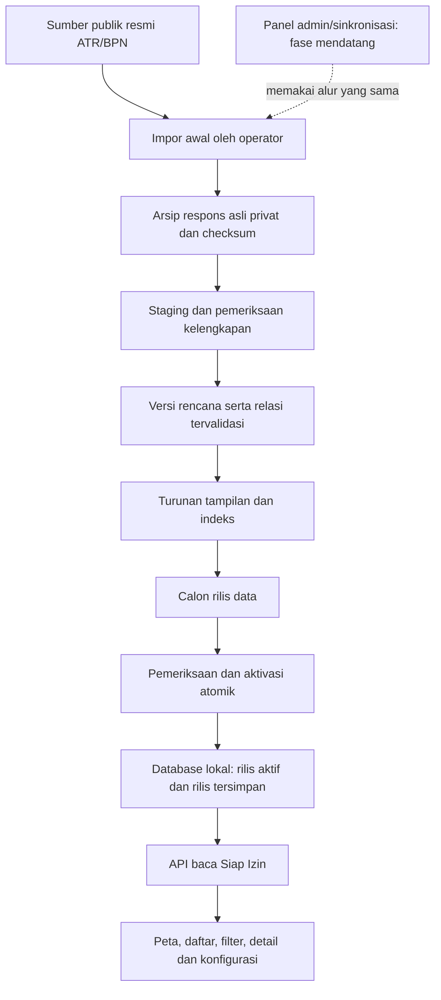
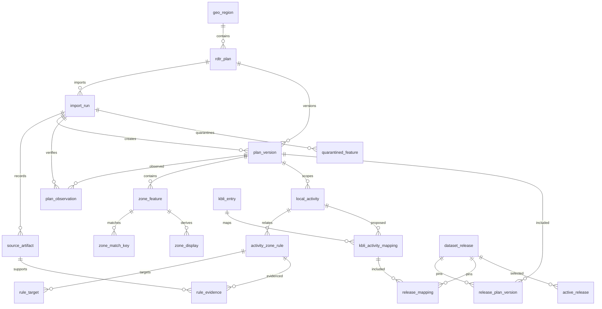

# Rancangan database RDTR mandiri — Siap Izin

**Versi:** 0.2 · checkpoint fondasi 28 Oktober 2026; model awal 27 Oktober 2026

**Pemilik kebutuhan:** Anton

**Status:** model target disertai fondasi lokal yang sudah diimplementasikan terbatas. Skema awal dan 1.708 fitur dua rencana sudah tersimpan; perbaikan/review fondasi belum selesai. Jalur API/peta dari DB dan aktivasi rilis belum berjalan. Lihat [checkpoint nyata](rdtr-db-foundation.md) dan [kontrak SQL](rdtr-db-schema-contract.md).

**Kaitan:** [PRD](../PRD.md), [keputusan](../decisions.md), [roadmap](../roadmap.md).

> Permintaan awal adalah desain saja. Sesudahnya Anton memberi izin implementasi lokal terpisah (D-16/DEC-17): runtime, skema dan impor awal arsip tervalidasi sudah dijalankan. Diagram/API/release di bawah tetap model target, bukan klaim seluruh alur selesai. Tidak ada panel admin, penjadwal, pengambilan massal baru atau publikasi dataset. Persetujuan implementasi lokal bukan bukti hak penyajian ulang produksi.

## 1. Keputusan, tujuan dan batas

### Yang telah diputuskan Anton

- Data polygon/batas zona dan relasi kegiatan RDTR diarahkan untuk disimpan pada penyimpanan/database sendiri.
- Permintaan awal adalah **rancangan**, kemudian dilanjutkan dengan persetujuan implementasi lokal dan impor awal bertahap; cakupan aktual serta gerbang review tercatat di checkpoint.
- Panel admin untuk sinkronisasi data terbaru dikerjakan **belakangan**; tidak menjadi prasyarat desain sekarang.
- Eksplorasi tetap memakai KBLI/wilayah; luas, jalan, agronomi dan generator kandidat tidak ditambahkan kembali ke modul ini.

### Rekomendasi teknis dalam rancangan

- PostgreSQL + PostGIS dipilih untuk fondasi pengembangan lokal; pilihan/deployment produksi, backup dan retensi tetap terpisah.
- Arsip respons sumber privat di penyimpanan berkas/objek yang dirujuk database; tidak menaruh seluruh raw GeoJSON di setiap baris atau respons browser.
- Jalur baca aplikasi hanya mengakses rilis data lokal yang telah diaktifkan. Pengambilan ATR/BPN dipisahkan sebagai pekerjaan impor awal yang dijalankan operator, bukan dipicu pembukaan peta.
- Turunan tampilan dan indeks selesai dibangun sebelum suatu rilis diaktifkan. Tidak perlu mengganti Leaflet atau langsung memakai vector tiles.

### Ditunda / bukan lingkup tahap ini

Panel admin, cron, sinkronisasi otomatis, webhook, pengiriman OSS, otomasi autentikasi, data klien, deployment berbayar dan publikasi database/arsip mentah. Mekanisme admin mendatang harus memakai kontrak impor/validasi yang sama, bukan jalur yang melewati pemeriksaan.

## 2. Masalah yang ditangani

Pada implementasi live saat ini, cache sumber berumur pendek, pengambilan sumber lengkap, validasi dan derivasi dapat berada di jalur permintaan pengguna. Konflik pekerjaan dapat menghasilkan `plan_busy`/`upstream_busy`; pembaruan sumber antara inventaris dan viewport dapat meminta muat ulang. Dokumen ini merancang pemisahan jalur tersebut, bukan mengklaim seluruh gangguan telah diperbaiki.

Baseline pengujian yang telah dimiliki adalah **5.994 fitur valid dari 16 rencana untuk subset kegiatan terkait `01273`**. Itu bukan jumlah seluruh polygon seluruh RDTR Sulawesi Tenggara dan bukan isi database baru. Perluasan pengambilan penuh adalah pekerjaan implementasi terpisah setelah rancangan diterima.

Tujuan terukur kelak: jumlah panggilan ATR/BPN dari alur baca peta/filter/detail adalah **nol**; sumber lambat tidak menahan permintaan baca lokal; gambar dan detail tidak tercampur antarrilis. Target detik, kapasitas pengguna dan ukuran database belum ditetapkan tanpa uji dataset dan perangkat sebenarnya.

## 3. Pemisahan jalur data

Tidak ada panah dari permintaan pengguna ke ATR/BPN. Peta dasar OpenStreetMap dan pemuatan pustaka browser adalah dependensi berbeda; rancangan ini tidak menjanjikan seluruh aplikasi/peta dasar dapat bekerja tanpa internet.

## 4. Model logis dan kamus data

Nama tabel dan tipe di bawah merupakan usulan, bukan DDL/migrasi yang telah dijalankan. `id` internal memakai UUID; kode resmi, kode kegiatan, versi KBLI dan ID rencana disimpan sesuai sumber. String `01273`, kode kegiatan dengan nol awal, titik pada KODUNK serta namespace ID internal tidak dinormalisasi menjadi angka atau diperbaiki dengan tebakan.

### 4.1 Katalog, impor dan versi sumber

| Tabel | Kunci dan kolom pokok | Fungsi / aturan |
|---|---|---|
| `geo_region` | PK `id`; `name`, `id_namespace`, `source_region_id` nullable | Wilayah tetap dapat tercatat meskipun belum punya ID sumber; ID internal tidak disebut ID resmi |
| `rdtr_plan` | PK `id`; FK `region_id`; `source_plan_id` text, `source_provider`, `name`, `catalog_state` | Unik `(source_provider, source_plan_id)` jika tersedia; tidak bergantung adanya pemetaan KBLI |
| `import_run` | PK `id`; FK `plan_id`; `batch_key`, `status`, waktu mulai/selesai, template query, `retrieval_scope`, hitungan ID/valid/karantina, alasan gagal, hash manifest | Satu percobaan impor untuk satu rencana/layer terpilih; `batch_key` mengelompokkan pekerjaan awal. Ini log impor awal, bukan penjadwal sinkronisasi |
| `source_artifact` | PK `id`; FK `import_run_id`; jenis respons, URL/parameter publik, waktu HTTP, status, SHA-256, ukuran, MIME, `blob_locator` | Respons katalog, kegiatan, metadata, ID/count dan batch geometri diarsipkan verbatim. Lokasi blob privat; header autentikasi tidak dicatat |
| `plan_version` | PK `id`; FK `plan_id`, `created_from_run_id`; `content_fingerprint`, layer/path, CRS native/output, definisi field, scope/kelengkapan, waktu sumber yang benar-benar tersedia | Unik `(plan_id, content_fingerprint)`; isi yang dipublikasikan immutable. Satu versi mengikat geometri, kegiatan dan bukti/aturan sumber yang divalidasi bersama |
| `plan_observation` | PK `id`; FK `plan_version_id`, `import_run_id`; waktu pemeriksaan berhasil, hasil `content_same`/`content_changed`, hasil validasi | Pengambilan ulang yang isinya sama mencatat observasi baru tanpa mengubah versi konten lama |

Satu rencana dapat memiliki beberapa versi/layer pilihan sepanjang sejarah. Konteks layer terpilih harus eksplisit pada `plan_version`; objek dari layer lain tidak digabung hanya karena OID-nya sama. Kebutuhan beberapa layer simultan per rencana memerlukan perluasan model terkontrol sebelum diterapkan.

### 4.2 Geometri sumber dan tampilan

| Tabel | Kunci dan kolom pokok | Fungsi / aturan |
|---|---|---|
| `zone_feature` | PK `id`; FK `plan_version_id`; `source_object_id` bigint, kode/nama zona/subzona, `source_properties` JSONB, `geom_original_4326`, bounds, hash geometri/properti | Unik `(plan_version_id, source_object_id)`. Hanya polygon/multipolygon valid yang lolos pemeriksaan. OID asal harus memang integer sesuai kontrak, bukan hasil paksaan string |
| `quarantined_feature` | PK `id`; FK `import_run_id`, `source_artifact_id`; ID asal bila dapat dibaca, locator fitur, kode/alasan kesalahan | Asli tetap ada di arsip; tidak diperbaiki diam-diam, tidak masuk indeks hasil sah atau kandidat |
| `zone_match_key` | FK komposit ke fitur dalam versi yang sama; `field_name`, `raw_value` text | Unik `(plan_version_id, zone_feature_id, field_name, raw_value)`. Mempertahankan nilai pencocokan seperti KODSZN atau KODUNK; bukan hanya nama zona |
| `zone_display` | FK komposit ke fitur dalam versi yang sama; `level`, versi algoritma, hash sumber, metode, parameter, alasan fallback, hasil QC, geometri tampilan | Unik `(plan_version_id, zone_feature_id, level, algorithm_version)`. Hanya untuk gambar; bukan pengganti geometri asli |

`geom_original_4326` berarti geometri sumber **sebagaimana diperoleh dengan output WGS84 yang diverifikasi**, bukan klaim bahwa koordinat native UTM turut diperoleh. Arsip verbatim tetap menjadi bukti input. `native_srid` dan `output_srid` dipisahkan; transformasi koordinat tidak sama dengan mengganti label SRID.[5]

Usulan tipe spasial: `geometry(Geometry,4326)` dengan pembatasan Polygon/MultiPolygon, tidak kosong dan valid, sehingga tidak harus mengubah Polygon menjadi MultiPolygon hanya untuk penyimpanan. `ST_IsValid` dapat menjadi salah satu pemeriksaan geometri, tetapi bukan bukti kelengkapan pengambilan atau keabsahan izin.[6]

Derivasi tetap mengikuti kontrak mutu yang sudah dirancang: coverage-aware pada kumpulan rencana yang aman; jika tidak aman, pertahankan geometri asli berlabel. Tidak mengganti proses ini dengan simplifikasi tiap fitur yang mengabaikan batas bersama. Parameter generalisasi bukan ketelitian survei. Asli tidak di-round, dissolve, clip atau repair diam-diam.

### 4.3 Kegiatan, ketentuan dan KBLI

| Tabel | Kunci dan kolom pokok | Fungsi / aturan |
|---|---|---|
| `local_activity` | PK `id`; FK `plan_version_id`; `source_activity_id` text, nama, payload mentah/locator | Unik `(plan_version_id, source_activity_id)`; ID kegiatan hanya lokal pada rencana/versinya |
| `activity_zone_rule` | PK `id`; FK komposit aktivitas dalam versi sama; `evidence_kind`, status kategori asal, kategori terurai bila diketahui, syarat/locator, `review_state` | Keanggotaan filter bukan matriks izin. Raw kategori dan kondisi dipertahankan; ketidakjelasan tetap unknown |
| `rule_target` | FK komposit aturan dalam versi sama; `field_name`, `raw_value`, cakupan tambahan bila ada | Satu target kode dapat cocok dengan banyak polygon. Nilai KODUNK bertitik tidak diganti KODSZN dan tidak disamakan lintasrencana |
| `rule_evidence` | PK `id`; FK aturan/versi dan artefak sumber; jenis bukti, locator JSON/halaman, `scope_kind`, ruang lingkup titik/blok/zona bila diketahui | Sampel titik ITBX tidak menjadi aturan seluruh polygon. Referensi dokumen tidak otomatis berarti syarat telah ditelaah |
| `kbli_entry` | PK komposit `(kbli_version, kbli_code)`; uraian, sumber dan scope yang tersedia | Kode text mempertahankan nol awal; ID kegiatan ATR/BPN tidak dimasukkan sebagai kode KBLI |
| `kbli_activity_mapping` | PK `id`; FK KBLI serta aktivitas dalam versi rencana sama; scope/asumsi terpisah, nomor revisi, dasar, reviewer, `review_state` | Setiap revisi immutable ketika dipakai rilis. Relasi belum direview tetap dapat menjadi bahan telaah, bukan keputusan kesesuaian |

Kategori aplikasi yang direncanakan: `unknown`, `allowed`, `limited`, `conditional`, `limited_conditional`, `prohibited`. Penerjemahan kategori sumber harus dibuktikan; angka atau label sumber yang belum dimengerti tidak dipaksa ke salah satunya. Sebuah relasi filter dapat memiliki `evidence_kind=filter_membership` dengan status izin tetap `unknown`.

Teks syarat, rujukan aturan dan cakupan bukti tidak boleh hilang saat data dinormalisasi. Perubahan interpretasi/kurasi aturan membutuhkan versi konten/revisi baru yang dapat ditelusuri, bukan UPDATE tersembunyi pada rilis aktif. Pemetaan KBLI yang ditinjau tidak otomatis mengesahkan seluruh kondisi proyek atau penerimaan OSS.

### 4.4 Rilis data lokal

| Tabel | Kunci dan kolom pokok | Fungsi / aturan |
|---|---|---|
| `dataset_release` | PK `id`; versi skema, hash manifest, status, waktu aktivasi, pengaktif, catatan cakupan | Satu paket pembacaan aplikasi yang immutable; aktivasi lokal tidak berarti izin publikasi internet |
| `release_plan_version` | PK `(release_id, plan_id)`; FK versi rencana milik plan yang sama; scope, hitungan dan status ketersediaan | Tepat satu versi per rencana dalam suatu rilis; entri katalog-only/unknown tidak diciptakan sebagai versi geometri kosong |
| `release_mapping` | PK `(release_id, mapping_id)`; `plan_id`, `plan_version_id`, FK komposit anggota rilis dan revisi mapping | Mengunci revisi pemetaan yang dipakai rilis. Mengedit review di tempat lain tidak mengubah hasil sesi yang sedang terbuka |
| `active_release` | PK `channel`; FK `release_id`; waktu/aktor penggantian | Pointer kecil yang diubah atomik setelah seluruh prasyarat calon rilis lolos |

### 4.5 Relasi dan batas integritas

Diagram adalah ringkasan kardinalitas, bukan seluruh DDL. Kontrak wajib untuk implementasi:

1. Semua anak geometri/aktivitas/aturan memakai FK komposit `(plan_version_id, parent_id)` ke pasangan yang unik pada induk; FK hanya ke UUID induk tidak cukup mencegah salah pengisian versi.
2. Keanggotaan rilis merujuk `(plan_id, plan_version_id)` yang memang milik plan tersebut. `release_mapping` merujuk versi yang benar-benar ada di `release_plan_version` serta mapping dalam versi yang sama.
3. Rilis harus memilih tepat revisi mapping yang dituju untuk setiap pasangan KBLI/scope/aktivitas; tidak memasukkan dua revisi yang saling menggantikan tanpa status konflik eksplisit.
4. Baris konten rilis tidak diedit oleh role aplikasi baca. Koreksi menghasilkan versi/revisi baru; rollback mengubah pointer, tidak menghapus riwayat.
5. PK/FK/UNIQUE dan CHECK dipakai sesuai kemampuannya. CHECK bukan cara memeriksa isi tabel lain; pemeriksaan lintastabel memakai FK komposit, prosedur aktivasi dan validasi transaksi yang dirancang pada implementasi.[1]

## 5. Cakupan dan versi: jangan menyamakan lengkap dengan tersedia

Simpan dimensi berikut secara terpisah pada manifest/keanggotaan rilis:

| Dimensi | Nilai rancangan | Makna |
|---|---|---|
| `catalog_state` | listed / not_listed / unknown | Tercantum dalam sumber yang diperiksa, bukan bukti semua wilayah punya/tidak punya RDTR |
| `geometry_scope` | complete_layer / filtered_subset / none / unknown | Apakah yang diambil seluruh layer atau subset dengan filter |
| `ingest_state` | ready / partial / failed / pending | Kondisi pekerjaan impor, bukan ketentuan kegiatan |
| `rules_scope` | source_matrix / filter_membership_only / partial / missing / unknown | Jenis/kelengkapan bukti relasi yang benar-benar diperoleh |
| `mapping_review_state` | unreviewed / reviewed / conflict / not_available | Kepastian relasi exact-KBLI; tidak diwariskan hanya karena geometri valid |
| `freshness_state` | dated_snapshot / unchecked_since_import / update_known / withdrawn | Status pemeliharaan data lokal, bukan label live palsu |

`complete_layer` hanya boleh diberikan jika semua ID source layer telah direkonsiliasi. Fitur valid + invalid yang diarsipkan dapat mencakup seluruh ID, tetapi jumlah yang boleh digambar tetap hanya fitur valid dan karantina harus terlihat. Jika pengambilan terputus, tidak dilabel lengkap.

Dua rencana tanpa calon relasi kegiatan tidak otomatis dilarang menyimpan geometri: impor penuh baru tidak bergantung pada `activity_id` yang cocok untuk `01273`. Sebaliknya, memiliki geometri tidak menghasilkan relasi kegiatan yang belum tersedia. Enam gap katalog pada baseline tidak berubah menjadi fitur kosong sukses di database.

Jika memakai arsip subset `01273` yang sudah ada untuk seed uji di tahap implementasi, manifest wajib `filtered_subset`, mempertahankan waktu sumber dan filter asal. Arsip itu tidak boleh dipromosikan menjadi seluruh layer atau diubah menjadi pengambilan live baru.

## 6. Alur impor awal — rancangan, bukan pekerjaan yang sudah dijalankan

1. Tetapkan manifest cakupan awal: rencana/layer publik Sulawesi Tenggara yang akan diambil, sumber dan tujuan penggunaan internal. Jangan menjanjikan semua rencana tanpa penemuan sumber.
2. Periksa ketentuan akses, penyimpanan dan penyajian ulang. Status izin yang belum jelas dicatat sebagai keputusan terbuka; akses publik atau persetujuan desain bukan bukti lisensi produksi.
3. Buat `import_run`; ambil katalog, metadata layer dan seluruh daftar kegiatan yang tersedia pada konteks rencana. Arsipkan respons asli dahulu, dengan URL/parameter/waktu/hash dan tanpa token/cookie.
4. Untuk geometri penuh, ambil daftar seluruh ID dan count layer dengan query yang tidak dibatasi satu KBLI. Endpoint ArcGIS mendukung pengambilan daftar ID serta pemilihan hasil berdasarkan object IDs; batas hasil fitur tidak boleh disalahartikan sebagai total layer.[7]
5. Ambil batch ID dengan batas jumlah, panjang URL dan waktu. Angka batas dari prototipe dapat menjadi titik awal pengujian, bukan diasumsikan optimal untuk semua layer. Retry terbatas untuk kegagalan sementara; hentikan/lanjutkan dari manifest, bukan memulai diam-diam atau menebak fitur hilang.
6. Rekonsiliasi ID unik yang diminta/diterima, count server, atribut, CRS, geometri, raw kategori/ketentuan dan cakupan aturan. Pisahkan invalid ke karantina dengan locator sumber; jangan membuat geometri pengganti.
7. Bangun kandidat `plan_version`, indeks pencocokan dan versi pemetaan yang tetap berstatus review sebenarnya. Parse hanya semantik yang diketahui; payload tak dikenal disimpan sebagai unknown untuk telaah.
8. Hitung fingerprint semantik yang deterministik atas konteks layer, geometri/properti, kegiatan serta bukti/aturan yang relevan. Hash tidak memasukkan waktu unduh, ID job atau status transport. Koordinat tidak dibulatkan untuk membuat hash tampak sama. Metadata perubahan yang bermakna tetap termasuk konteks.
9. Jika konten sama dengan versi yang ada, simpan observasi baru dan kaitan run; jangan membangun ulang LOD atau mengganti ID konten hanya karena waktu pengambilan berubah. Arsip mentah setiap observasi tetap dapat dilacak.
10. Jika konten berbeda, selesaikan validasi, turunan LOD dan indeks pada versi baru sebelum membuat calon rilis. Raw artifact dan geometri sumber tidak ditimpa.
11. Calon rilis mengunci versi per rencana dan revisi mapping. Kegagalan satu rencana menahan aktivasi lengkap, atau membutuhkan aktivasi parsial yang sengaja disetujui dan berlabel; tidak menganggap gagal sebagai zero.
12. Aktivasi pointer dilakukan dalam transaksi setelah seluruh pemeriksaan lolos. Transaksi menyediakan perubahan menyeluruh atau rollback; berkas blob disiapkan/diverifikasi lebih dahulu karena transaksi database tidak otomatis mentransaksikan penyimpanan berkas.[2]

Impor awal kelak boleh berupa perintah operator satu kali dengan log dan persetujuan aktivasi. Itu bukan panel admin atau sinkronisasi otomatis. Tidak ada crawler nasional, akses berakun, pencarian token atau penggunaan proxy selain jalur publik resmi yang terverifikasi dalam scope ini.

## 7. Sesi baca yang stabil dan penghindaran reload berulang

- Bootstrap membaca `active_release` sekali dan mengembalikan `release_id` beserta hash manifest. Seluruh permintaan peta, daftar, filter dan detail berikutnya membawa ID rilis itu.
- Rilis baru yang diaktifkan di tengah sesi tidak mengganti sebagian respons sesi lama. Tawarkan data baru secara eksplisit; jangan mencampur gambar lama dengan atribut/rule baru.
- Perubahan kriteria di sesi yang sama tetap memakai rilis terpilih, kecuali pengguna memilih pindah versi. Kriteria baru yang belum dicakup rilis menghasilkan unknown, bukan panggilan langsung ATR/BPN.
- Sesi lama tetap dapat membaca rilis tersimpan sesuai kebijakan retensi. Bila rilis ditarik/dihapus karena alasan yang tercatat, API meminta pemilihan ulang; tidak diam-diam beralih ke current.
- Waktu pengambilan, waktu pemeriksaan ulang dan tanggal berlaku peraturan adalah field terpisah. Tanggal berlaku boleh null bila belum terbukti.
- Sampai sinkronisasi dibuat, UI wajib mengatakan **dataset lokal bertanggal; sinkronisasi otomatis belum tersedia**. Bukan `live` atau `terbaru` hanya karena database merespons cepat.

Tidak ada batas umur baru yang dianggap disetujui dalam dokumen ini. Kebijakan TTL 300 detik/stale pada adapter live lama tetap berlaku selama kode itu digunakan. Rancangan database memakai sumber `local_dataset` dan kontrak versi baru secara eksplisit; bukan memperpanjang TTL atau menyamarkan snapshot lama pada adapter lama.

## 8. Kontrak API baca yang diusulkan

Namespace baru untuk membedakan kebijakan sumber: **`/api/v2/…`**, belum dibuat. Parameter berikut adalah rancangan, bukan endpoint yang dapat dipanggil sekarang.

| Rute rancangan | Isi / batas |
|---|---|
| `GET /api/v2/map/bootstrap` | Kriteria tervalidasi, `release_id`, manifest, cakupan/review/freshness per rencana, hitungan sumber yang diketahui dan bounds navigasi; tanpa seluruh geometri |
| `GET /api/v2/zones` | Wajib rilis/kriteria, level dan bbox; geometri tampilan pada viewport saja, metadata sumber, status kelengkapan dan cursor jika hasil melebihi anggaran |
| `GET /api/v2/zone-index` | Daftar seluruh fitur relevan dalam rilis/kriteria, berpaginasi stabil menurut identitas; ID, label, bounds navigasi tanpa geometri penuh. Navigasi keyboard tidak terbatas pada layer aktif |
| `GET /api/v2/zones/{feature_id}` | Atribut/bukti/relasi dalam rilis yang sama dan bounds navigasi; tidak mengunduh geometri asli untuk membuka detail |

Semua respons membawa `release_id`, `plan_version_id` yang terkait, status review, waktu sumber, cakupan dan hitungan yang jelas. `catalog_plan_count`, `known_available_feature_count` (nullable bila belum diketahui), `inventory_loaded_count` dan `drawn_feature_count` tidak disamakan. Status datanya berbeda dari status izin.

Hasil 0 berarti tidak ditemukan dalam sumber/versi/filter yang benar-benar diperiksa; bukan pernyataan seluruh wilayah tanpa RDTR atau kegiatan dilarang. Kegagalan/ketiadaan cakupan tetap tercantum. Cursor mengikat rilis, kriteria dan urutan; cursor versi/filter lain ditolak. Bila viewport terpotong oleh anggaran, respons wajib menunjukkan partial/lanjutan, tidak mengaku lengkap.

Konfigurasi ekspor tetap allowlist tanpa geometri, source bounds atau parameter kandidat; tambahkan identitas rilis/versi dan provenance seperlunya. Semua query memakai parameter terikat dan allowlist; pengguna tidak dapat memasukkan URL sumber, SQL atau nama tabel/field bebas.

## 9. Rencana indeks dan performa

Usulan indeks GiST pada `zone_feature.geom_original_4326`, indeks B-tree untuk FK/identitas/rilis serta pasangan `(plan_version_id, field_name, raw_value)` pada kunci pencocokan. Indeks spasial membantu mempersempit kandidat pencarian; perlu diuji pada query dan distribusi data sebenarnya, bukan dianggap otomatis mempercepat setiap query.[3]

Alur query viewport: pilih anggota rilis dan relasi KBLI yang sesuai status bukti → cocokkan kunci zona per rencana → filter interseksi **geometri sumber asli** dengan bbox → ambil turunan LOD yang terikat fitur/versi tersebut. `ST_Intersects` menyediakan pengujian perpotongan; envelope semata bukan pengganti polygon untuk kelengkapan subset.[4]

Bootstrap tidak mengirim seluruh 5.994 polygon atau membangun LOD. Turunan dan indeks disiapkan sebelum aktivasi. Jumlah inventaris dihitung dari versi/kriteria di server, sedangkan daftar dirender berpaginasi; tidak perlu memuat seluruh koordinat untuk menampilkan counter atau akses keyboard.

Ukuran respons, vertex, waktu SQL, serialisasi, request-ke-render, heap browser dan pengambilan awal diukur terpisah. Uji baca hangat/dingin lokal berbeda dari impor awal dan latensi ATR/BPN. Vector tiles, subdivisi geometri atau ganti renderer baru dievaluasi jika hasil ukur masih membutuhkan; tidak menjadi syarat tahap desain.

## 10. Kebutuhan rancangan dan uji penerimaan

Ini spesifikasi uji untuk implementasi mendatang; **belum dijalankan terhadap database**.

| ID | Kebutuhan | Kaitan PRD |
|---|---|---|
| DBR-01 | Penyimpanan RDTR mandiri dengan jalur baca bebas permintaan ATR/BPN | F-44 |
| DBR-02 | Impor awal lengkap-terukur, arsip verbatim dan karantina; subset tidak disebut layer penuh | F-45 |
| DBR-03 | Rilis immutable mengunci versi rencana dan revisi mapping sepanjang sesi | F-46 |
| DBR-04 | Identitas kegiatan/zona/rule dipisahkan menurut rencana/versi dan bukti | F-47 |
| DBR-05 | Geometri asli dipisahkan dari turunan yang dipersiapkan sebelum aktivasi | F-48 |
| DBR-06 | Viewport dan daftar sumber berpaginasi memakai query lokal dengan hitungan jujur | F-48 |
| DBR-07 | Provenance, waktu sumber dan status dataset lokal terlihat tanpa label live palsu | F-49 |
| DBR-08 | Aktivasi parsial, kegagalan dan rollback mempertahankan data valid serta histori | F-46 |
| DBR-09 | Sinkronisasi/panel admin belum dibuat; log impor awal tidak menyamarkan penjadwal | F-49 |
| DBR-10 | Hak akses, backup dan pemulihan menjaga rilis, database serta blob sumber bersama | F-44 |

| ID | Skenario wajib | Hasil yang diharapkan | Kaitan |
|---|---|---|---|
| DBT-01 | Akses domain ATR/BPN diblokir setelah rilis lokal tersedia; buka filter/pan/detail | Tidak ada request ATR/BPN dari jalur baca; zona/bukti lokal tetap tersedia, peta dasar diuji terpisah | DBR-01, UAT-51 |
| DBT-02 | Impor menggunakan subset `01273`, atau ID hilang/duplikat/invalid | Scope subset/partial dan karantina terlihat; tidak boleh mengaku full-layer atau membuat data pengganti | DBR-02, UAT-52 |
| DBT-03 | Aktifkan rilis lain di antara request inventaris, viewport dan detail | Sesi tetap satu rilis; hasil tidak bercampur. Rilis ditarik meminta pindah secara eksplisit | DBR-03, UAT-53 |
| DBT-04 | OID/kode kegiatan sama lintasrencana, KODUNK bertitik, keanggotaan filter tanpa ITBX | FK/kunci menjaga konteks; literal terpelihara, izin unknown dan bukti titik tidak digeneralisasi | DBR-04, UAT-54 |
| DBT-05 | Turunan LOD belum selesai/invalid atau bbox hanya overlap envelope | Calon rilis tidak tayang tanpa fallback aman berlabel; subset dibandingkan polygon asli, bukan envelope saja | DBR-05, UAT-55 |
| DBT-06 | Banyak fitur dan halaman; cursor salah rilis/filter; anggaran viewport terlampaui | Daftar seluruh fitur tetap terjangkau, cursor salah ditolak dan partial eksplisit; tanpa full geometry di bootstrap | DBR-06, UAT-55 |
| DBT-07 | Impor ulang sama konten, data bertanggal lama, sumber offline dan panel admin belum ada | Tidak mengubah ID konten hanya karena waktu; observasi tercatat, bukan live/terbaru atau sync sukses palsu | DBR-07, DBR-09, UAT-56 |
| DBT-08 | Impor terputus, satu rencana gagal atau aktivasi transaksi gagal | Rilis lama tetap aktif; aktivasi parsial harus disengaja, rollback dan resume tidak menggandakan objek | DBR-08, UAT-57 |
| DBT-09 | Pulihkan DB tanpa blob lalu dengan arsip lengkap; pengguna baca mencoba menulis | Arsip tak lengkap terdeteksi; pemulihan utuh diuji dan role baca tidak bisa mengubah sumber/rilis | DBR-10, UAT-58 |

## 11. Operasi, keamanan dan pekerjaan yang ditunda

Usulan role minimal: aplikasi baca, operator impor awal dan pengaktif rilis. Hak minimum, koneksi aman dan pemisahan lingkungan perlu diuji sebelum penggunaan nyata; tidak ada kredensial atau data klien di rancangan. Aktivasi lokal dan publikasi internet merupakan otorisasi berbeda.

API baca memakai projection/allowlist eksplisit; `source_properties`, payload raw, lokasi blob dan isi tabel tidak dikirim dengan spread/SELECT-all ke browser. Locator arsip dikelola server, bukan path masukan pengguna. Teks/JSON sumber diperlakukan sebagai data tidak tepercaya, tidak dirender sebagai HTML atau dijalankan sebagai instruksi. Pengambilan impor dibatasi allowlist sumber resmi; bukan open proxy berdasarkan URL dari klien.

Backup mencakup database, arsip sumber/checksum, manifest rilis dan konfigurasi yang diperlukan. Frekuensi/retensi, target pemulihan, tempat hosting dan biaya belum disetujui. Penghapusan rilis harus mempertimbangkan sesi dan bukti historis yang masih merujuknya; jangan menghapus versi hanya untuk menghemat tempat tanpa kebijakan.

Untuk fase admin mendatang, pertahankan ID import/observasi, staging, validasi dan aktivasi; desain RBAC admin, antrean, jadwal, retry, notifikasi dan auditnya nanti. Tidak ada endpoint sinkronisasi, scheduler atau kontrol admin yang dibuat pada tahap sekarang.

## 12. Urutan implementasi setelah persetujuan terpisah

1. Tinjau model ini, ruang penggunaan dan gerbang hak data; pilih deployment serta versi PostgreSQL/PostGIS. Tidak memerlukan semua keputusan sinkronisasi admin untuk memulai desain.
2. Implementasikan skema, kontrak dan validator melalui uji; satu rencana kecil dan satu besar menjadi irisan pembuktian, bukan pengurangan target Sulawesi Tenggara.
3. Implementasikan impor awal yang dapat dilanjutkan dan diverifikasi. Arsip lama boleh menjadi seed uji berlabel, bukan dianggap fresh/full-layer.
4. Perluas pengambilan pada rencana/layer Sulawesi Tenggara yang benar-benar tersedia, dengan bukti kelengkapan/unknown; tidak menyatakan selesai bila target gagal.
5. Siapkan LOD/indeks, aktifkan rilis lokal dan alihkan jalur baca lewat API versi baru; uji blok ATR/BPN, versi lintas-request, rollback, keyboard/seluler dan performa.
6. Setelah jalur baca stabil dan disetujui, rancang/bangun panel admin serta sinkronisasi sebagai pekerjaan terpisah.

### Keputusan yang masih terbuka, bukan penghambat penulisan rancangan

- Hak penyimpanan/penyajian ulang dataset dan bukti ketentuan penyedia; penggunaan internal versus publik.
- Lokasi deployment, anggaran, backup/retensi dan pemegang kewenangan aktivasi/review.
- Batas umur dataset untuk eksplorasi dan untuk pemeriksaan/pengajuan resmi; tidak ditetapkan sama dengan TTL cache lama.
- Kelengkapan matriks aturan dan pemetaan exact-KBLI; ketiadaan bukti tetap unknown.
- Data penuh yang benar-benar dapat diambil dan ukuran akhir setelah impor; bukan angka subset baseline.

**Definition of Done tahap sekarang:** rancangan/model/relasi/alur impor dan penerimaan tertulis; PRD/keputusan/roadmap selaras; sumber teknis dan tautan diperiksa; tidak ada install, migrasi, impor atau panel admin yang diklaim sudah dijalankan. Kelayakan SQL, performa DB dan penerimaan OSS masih memerlukan implementasi serta pengujian terpisah.

## Sources

[1] https://www.postgresql.org/docs/current/ddl-constraints.html
[2] https://www.postgresql.org/docs/current/tutorial-transactions.html
[3] https://postgis.net/workshops/postgis-intro/indexing.html
[4] https://postgis.net/docs/ST_Intersects.html
[5] https://postgis.net/docs/ST_Transform.html
[6] https://postgis.net/docs/ST_IsValid.html
[7] https://developers.arcgis.com/rest/services-reference/enterprise/query-map-service-layer
